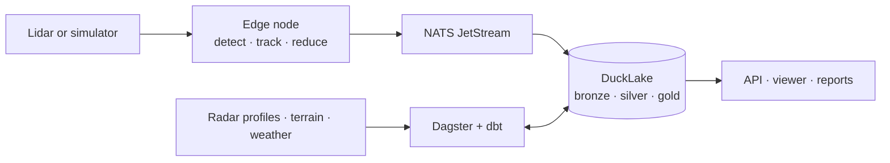

# Apus

**Lidar-based bird-flight monitoring.** Apus turns raw lidar returns into bird tracks with
deterministic, explainable methods, then runs them through a production-grade data platform:
edge streaming, a lakehouse, orchestration, data contracts, quality checks and dashboards.

> **Status:** planning is complete and implementation is starting. Research, architecture and
> decisions are in [`docs/`](docs/); the work ahead is in [ROADMAP.md](ROADMAP.md).

*Apus* is the genus of the swifts, birds that spend almost their entire lives in the air. It is
also a constellation of the southern sky.

## What it does

The target for version 1.0:

- **Simulates a lidar at a virtual site** as a digital twin: real terrain and vegetation from the
  Dutch national elevation survey (AHN), bird arrivals driven by real weather-radar migration
  profiles (Aloft), and clutter and wind from real weather (Open-Meteo).
- **Detects and tracks birds on the edge device**: background modelling in range-image space,
  connected-component segmentation, IMM-Kalman tracking with gating and optimal assignment.
- **Explains every result.** Behaviour classes (large bird, small bird, flock, insect,
  precipitation) come from a versioned rule set, and every track records the rule and values
  that decided its class. No machine-learning models are used.
- **Reduces data on the device**, from about 680 GB per day of raw returns to at most 50 MB per
  site-day of tracks, health data and short event snippets. Near-ground returns never leave the
  device.
- **Streams with store-and-forward** over NATS JetStream, so a lost uplink loses nothing.
- **Runs a lakehouse** (DuckLake on S3-compatible storage), orchestrated by Dagster and
  transformed with dbt, with data contracts, quality checks and storage budgets on every
  dataset.
- **Produces ecological outputs**: hourly passage rates corrected for detectability,
  flight-height distributions, comparisons with weather-radar profiles, and collision-risk
  estimates for a virtual wind turbine with the Band (2012) model.
- **Serves** a read API, a 3D web viewer of tracks over terrain, and a static public demo.

## Who it's for

- **Ecologists and environmental consultants** evaluating lidar for monitoring birds near wind
  farms, airfields and other structures, who need methods they can audit.
- **Owners of a lidar sensor** who want an open pipeline from packets to tracks (real-sensor
  adapters are planned in M18).
- **Data and platform engineers** who want a complete, realistic reference project that combines
  streaming and batch data engineering with DevOps practice.

## Built with

| Area | Tools |
| :-- | :-- |
| Language and tooling | Python 3.13, uv workspaces, Ruff, mypy (strict), pytest, Hypothesis, just, pre-commit, gitleaks |
| Perception | NumPy, SciPy, Numba, laspy/lazrs (LAZ and COPC), pyproj |
| Messaging | NATS JetStream with leaf nodes, Protocol Buffers with Buf |
| Lakehouse | DuckLake on PostgreSQL, Parquet on SeaweedFS (S3 API), DuckDB, Polars, PyArrow |
| Orchestration and transformation | Dagster, dbt-core with dbt-duckdb |
| Data quality | Open Data Contract Standard with datacontract-cli, Pandera, dbt tests, Dagster asset checks |
| Serving | FastAPI, TypeScript, Vite, deck.gl, MapLibre, DuckDB-WASM |
| Platform | Docker, Compose, k3d/k3s, Helm, Argo CD, SOPS, OpenTofu, OpenTelemetry, Grafana |
| Delivery | GitHub Actions, release-please, Syft, Cosign, OpenSSF Scorecard, Renovate, Zensical docs |

Every choice, its version and the alternatives considered are in the
[technology landscape](docs/research/03-technology-landscape.md) and the
[architecture decision records](docs/adr/README.md).

## How it works



Details: [architecture](docs/architecture.md).

## How to run it

The workspace, tooling and tests are in place; the product itself is being built milestone by
milestone. You need Git, [uv](https://docs.astral.sh/uv/) (it fetches Python 3.13 itself) and
[just](https://just.systems/) (`uv tool install rust-just`).

```sh
git clone https://github.com/soheil-mp/apus.git
cd apus
just setup   # install the workspace, dev tools and git hooks
just check   # lint, import boundaries, strict type check, tests with coverage
just         # list every recipe
```

A devcontainer in `.devcontainer/` provides the same tools for VS Code or GitHub Codespaces.

Coming with the walking skeleton (M1): `just up` starts the local platform with Docker Compose
and `just e2e` runs a seeded scenario end to end. Until then those recipes say so and exit.

## Repository layout

```text
packages/       Python workspace members (uv): apus-core, apus-sim, apus-edge,
                apus-ingest, apus-pipelines, apus-api
tests/          unit, integration and end-to-end tests for all packages
scripts/        repository tooling (GitHub settings, roadmap-to-issues sync)
docs/
  research/     domain research, data sources, technology landscape
  adr/          architecture decision records
  architecture.md
ROADMAP.md      milestones, estimates, targets and risks
```

Directories still to come (dbt project, schemas, contracts, web viewer, deployment) are
described in [ADR-0010](docs/adr/0010-python-toolchain-monorepo.md).

## Status and plans

- **Done:** domain research with verified references, live checks of every data source, tool
  selection, ten ADRs, the target architecture and the roadmap.
- **Next:** M0 (engineering foundations), then M1, a thin end-to-end slice from simulated
  packets to an API response.
- **Ahead:** 832 hours of planned work in 21 milestones, listed with estimates and exit criteria
  in [ROADMAP.md](ROADMAP.md) and mirrored as [GitHub issues](https://github.com/soheil-mp/apus/issues).

## Data and attribution

Apus uses only synthetic data and public environmental data. It contains no personal data.

- **AHN** (Actueel Hoogtebestand Nederland): AHN1–4 under CC0, AHN5–6 under CC BY 4.0.
- **Aloft** weather-radar bird profiles: CC0. Please cite Desmet et al. (2025) and acknowledge
  OPERA, as requested in the [Aloft FAQ](https://aloftdata.eu/faq/).
- **Open-Meteo** weather data: CC BY 4.0, [open-meteo.com](https://open-meteo.com/). The free
  API is used within its non-commercial terms.

No data files are stored in this repository; pipelines fetch small windows when they run.

## License

MIT, see [LICENSE](LICENSE).
