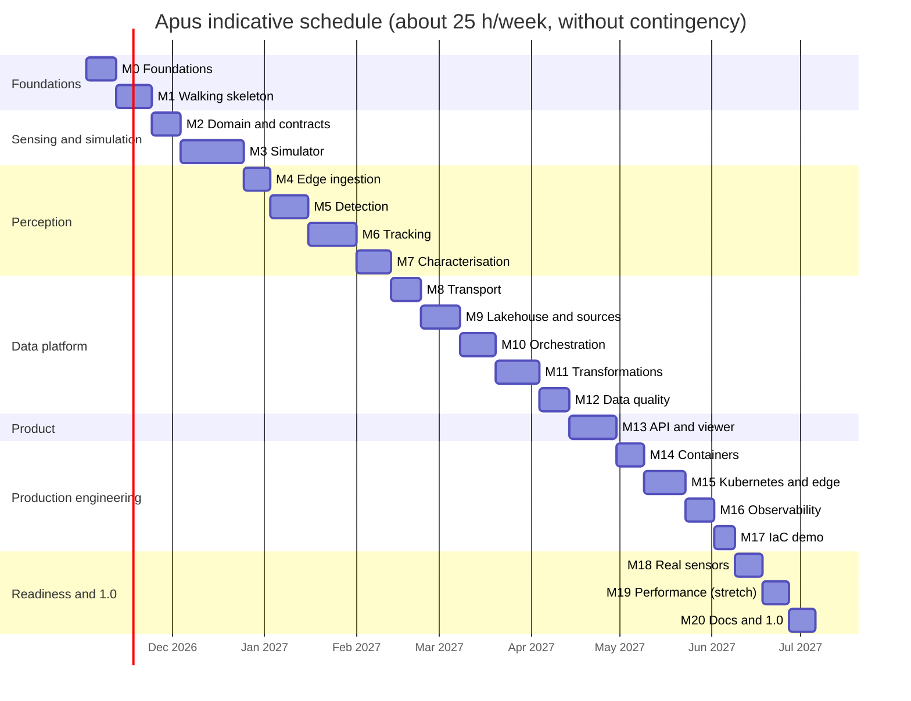

# Roadmap

> **Status (2026-11-02):** planning is complete: research, architecture and the first ten ADRs
> are in [`docs/`](docs/). No product code exists yet. The next item is **M0.3**.

Apus is built in seven phases and 21 milestones. A thin end-to-end slice comes first (M1), and
every later milestone deepens one stage of that slice, so the project works from early on and
gets better with each step.

## How to read this roadmap

- **IDs** are `M<milestone>.<item>`. Each item becomes one GitHub issue (M0.12); this file stays
  the source of truth.
- **Estimates** are hours of focused work, including tests and documentation for that item.
- **`[x]`** marks items merged to `main`. Exit criteria must hold before a milestone closes.
- Items marked *stretch* are optional within their milestone.
- Background for every decision: [domain research](docs/research/01-domain.md),
  [data sources](docs/research/02-data-sources.md),
  [technology landscape](docs/research/03-technology-landscape.md),
  [architecture](docs/architecture.md) and [ADRs](docs/adr/README.md).

## Summary

| Phase | Milestone | Hours | Release |
| :-- | :-- | --: | :-- |
| 0. Foundations | [M0 Engineering foundations](#m0--engineering-foundations) | 33 | |
| 1. Walking skeleton | [M1 Thin end-to-end slice](#m1--walking-skeleton-thin-end-to-end-slice) | 40 | v0.1.0 |
| 2. Sensing and simulation | [M2 Domain model, coordinates and contracts](#m2--domain-model-coordinates-and-contracts) | 34 | |
| | [M3 Lidar, scene and bird simulator](#m3--lidar-scene-and-bird-simulator) | 72 | v0.2.0 |
| 3. Perception on the edge | [M4 Edge ingestion and frame assembly](#m4--edge-ingestion-and-frame-assembly) | 30 | |
| | [M5 Detection](#m5--detection) | 46 | |
| | [M6 Multi-target tracking](#m6--multi-target-tracking) | 56 | |
| | [M7 Flight characterisation and explainable rules](#m7--flight-characterisation-and-explainable-rules) | 42 | v0.3.0 |
| 4. Data platform | [M8 Edge-to-platform transport](#m8--edge-to-platform-transport) | 34 | |
| | [M9 Lakehouse and external ingestion](#m9--lakehouse-and-external-ingestion) | 46 | |
| | [M10 Orchestration](#m10--orchestration-with-dagster) | 40 | |
| | [M11 Transformations and analytics](#m11--transformations-and-analytics) | 52 | |
| | [M12 Data quality and contracts in operation](#m12--data-quality-and-contracts-in-operation) | 36 | v0.4.0 |
| 5. Product surface | [M13 Read API and web viewer](#m13--read-api-and-web-viewer) | 56 | v0.5.0 |
| 6. Production engineering | [M14 Containers and supply chain](#m14--containers-and-supply-chain) | 30 | |
| | [M15 Kubernetes, GitOps and edge deployment](#m15--kubernetes-gitops-and-edge-deployment) | 50 | |
| | [M16 Observability and SRE](#m16--observability-and-sre) | 36 | |
| | [M17 Infrastructure as code (optional cloud demo)](#m17--infrastructure-as-code-optional-cloud-demo) | 24 | v0.6.0 |
| 7. Real-world readiness and 1.0 | [M18 Real-sensor readiness](#m18--real-sensor-readiness) | 32 | |
| | [M19 Performance and Rust acceleration (stretch)](#m19--performance-and-rust-acceleration-stretch) | 30 | |
| | [M20 Documentation, write-up and 1.0](#m20--documentation-write-up-and-10-release) | 30 | v1.0.0 |
| | **Total** | **849** | |

**Done:** 8 h (M0.1, M0.2). **Open:** 841 h. With 15 % contingency, that is about 970 hours:
roughly nine months at 25 hours a week.

### Indicative schedule

## Principles

1. **Deterministic and explainable.** No learned models; every classification carries its
   reasons ([ADR-0002](docs/adr/0002-deterministic-explainable-perception.md)).
2. **Small data by design.** Read windows, reduce at the edge, budget every dataset
   ([ADR-0004](docs/adr/0004-edge-first-data-reduction.md)).
3. **Reproducible.** Seeded scenarios, pinned tools, idempotent partitions.
4. **Contracts first.** Schemas and data contracts change before the code that uses them
   ([ADR-0009](docs/adr/0009-schemas-and-data-contracts.md)).
5. **Privacy on the device.** Synthetic or public environmental data only; near-ground returns
   never leave the edge.
6. **Everything as code.** Infrastructure, dashboards, alerts, policies, repository settings.
7. **Honest science.** Limitations, such as simulation gaps, are written next to the results.

## Definition of done (every item)

- [ ] Merged by pull request with CI green; conventional commit messages.
- [ ] Tests at the right level (unit, property, integration, end-to-end); coverage does not drop.
- [ ] `ruff`, `mypy --strict` and `lint-imports` pass.
- [ ] Docs updated: reference for interfaces, a how-to for anything a user runs.
- [ ] Schemas and contracts updated; breaking changes versioned.
- [ ] No secrets, no personal data, data budgets respected.
- [ ] An ADR is added or superseded when a recorded decision changes.
- [ ] This file is ticked and README.md is updated if the change affects it.

---

## Phase 0: Foundations

### M0 · Engineering foundations

**Goal:** a repository where every later change is linted, typed, tested, documented and
released automatically.

- [x] **M0.1** (2 h) Repository bootstrap: MIT licence, `.gitignore`, `.editorconfig`,
  `.gitattributes`, `.env.example`, pre-commit with gitleaks, codespell, markdownlint and
  Conventional Commits.
- [x] **M0.2** (6 h) Planning: domain research, data sources verified against the live
  services, technology landscape, ten ADRs, architecture and this roadmap.
- [ ] **M0.3** (4 h) uv workspace with the six packages from
  [ADR-0010](docs/adr/0010-python-toolchain-monorepo.md); Python 3.13 pin and `uv.lock`; Ruff,
  mypy (strict), pytest and coverage (branch coverage, fail under 85 %) configured.
- [ ] **M0.4** (2 h) `justfile` (`setup`, `lint`, `fmt`, `typecheck`, `test`, `docs`, `up`,
  `down`, `e2e`) and a devcontainer with the same tool versions.
- [ ] **M0.5** (2 h) Extend pre-commit with Ruff, mypy, actionlint, hadolint, ShellCheck,
  yamllint, check-jsonschema and import-linter.
- [ ] **M0.6** (5 h) GitHub Actions CI: lint, type check and test (matrix by package), uv
  cache, concurrency groups, read-only default permissions, actions pinned by commit SHA,
  coverage in the job summary.
- [ ] **M0.7** (2 h) Dependency policy: Renovate (grouped, scheduled, automerge for patch
  updates of dev tools) and a licence check against the allowlist in
  [technology landscape §4](docs/research/03-technology-landscape.md#4-licence-policy-for-dependencies),
  including a deny list for machine-learning frameworks.
- [ ] **M0.8** (2 h) Community files: `CONTRIBUTING.md`, `CODE_OF_CONDUCT.md` (Contributor
  Covenant 2.1), `SECURITY.md` (private reporting), `CODEOWNERS`, issue forms (bug, feature,
  research spike) and a pull-request template that asks whether an ADR is needed.
- [ ] **M0.9** (2 h) Release automation with release-please (manifest mode), `CHANGELOG.md`,
  tags `vX.Y.Z`, and `CITATION.cff`.
- [ ] **M0.10** (3 h) Documentation site with Zensical: Diátaxis structure, research and ADRs
  included, Mermaid enabled, deployed to GitHub Pages, link checking in CI.
- [ ] **M0.11** (1 h) Repository settings as code: a `gh api` script for the `main` ruleset
  (pull request required, required checks, no force-push, no deletion) and for secret scanning
  with push protection.
- [ ] **M0.12** (2 h) Idempotent script that creates GitHub milestones, labels and one issue
  per roadmap item.

**Exit criteria:** CI is green on `main`; the docs site is live; `just setup && just test`
works on a fresh clone.

---

## Phase 1: Walking skeleton

### M1 · Walking skeleton (thin end-to-end slice)

**Goal:** one straight-flying synthetic bird travels from simulated packets to a gold table and
an API response, in Docker Compose and in CI.

- [ ] **M1.1** (5 h) Minimal simulator: one sensor pose, empty sky, one bird on a straight line
  at constant speed, ideal sensor; frames to a UDP socket, ground truth to a file.
- [ ] **M1.2** (5 h) Minimal edge: receive, assemble frames, treat any return in the sky as
  foreground, cluster by distance, nearest-neighbour tracking, publish tracks as Protobuf.
- [ ] **M1.3** (3 h) First Protobuf schema (`TrackUpdate v1`) with `buf lint` in CI.
- [ ] **M1.4** (4 h) Compose profile `core`: NATS with JetStream, SeaweedFS (S3), PostgreSQL;
  health checks; configuration from `.env`.
- [ ] **M1.5** (5 h) Landing consumer: pull from JetStream, write Parquet micro-batches, commit
  them to a DuckLake bronze table.
- [ ] **M1.6** (4 h) Dagster code location with one asset that runs the dbt project and one
  asset check.
- [ ] **M1.7** (3 h) dbt project on dbt-duckdb attached to DuckLake with one staging and one mart
  model; DuckDB 2.0, DuckLake and dbt-duckdb versions verified to work together and pinned.
- [ ] **M1.8** (3 h) FastAPI endpoint `GET /v1/tracks` reading the mart.
- [ ] **M1.9** (5 h) End-to-end test `just e2e`: start the stack, run a 30-second seeded
  scenario, assert the track count and the bird's speed match ground truth within tolerance;
  runs in CI.
- [ ] **M1.10** (3 h) import-linter contracts: the edge package cannot import the ground-truth
  module or the pipelines ([ADR-0003](docs/adr/0003-radar-driven-synthetic-lidar.md)).

**Exit criteria:** `just e2e` passes locally and in CI in under 10 minutes; a "first run"
tutorial documents the slice. **Release v0.1.0.**

---

## Phase 2: Sensing and simulation

### M2 · Domain model, coordinates and contracts

**Goal:** shared types, coordinate systems and schemas that every package relies on.

- [ ] **M2.1** (5 h) Core domain types: `Site`, `SensorPose`, `Frame` (range image and
  per-point time), `Detection`, `TrackState`, `Track`, `Advisory`. Pydantic models at
  boundaries, NumPy structured arrays in hot paths.
- [ ] **M2.2** (6 h) Coordinate frames: sensor spherical, sensor Cartesian, local ENU at the
  site, RD New (EPSG:28992) and WGS84 via pyproj; Hypothesis round-trip tests with error bounds.
- [ ] **M2.3** (2 h) Time model: device monotonic clock versus UTC, clock-offset field,
  per-point timestamps, written policy for clock skew.
- [ ] **M2.4** (2 h) Units and naming conventions: SI units in storage, unit suffixes in column
  names (for example `speed_mps`, `height_agl_m`).
- [ ] **M2.5** (6 h) Full Protobuf set: detections, track updates, health, snippet notices,
  advisories; `buf breaking` against `main` in CI; generated code under `gen/`.
- [ ] **M2.6** (3 h) Configuration with pydantic-settings (layered YAML and environment); site
  schema (location, sensor pose, turbine geometry, thresholds) exported as JSON Schema.
- [ ] **M2.7** (6 h) ODCS v3 data contracts for every table in
  [architecture §3](docs/architecture.md#3-data-flow-and-layers), with units, semantics,
  quality rules and storage budgets; `datacontract lint` in CI.
- [ ] **M2.8** (2 h) Virtual demo site within about 25 km of the Herwijnen radar (`nlhrw`):
  AHN sheet, sensor pose, and a made-up turbine layout using the IEA Wind 3.4 MW reference
  geometry (130 m rotor, 110 m hub).
- [ ] **M2.9** (2 h) Reference pages for schemas and contracts generated into the docs site.

**Exit criteria:** contracts lint clean; coordinate round trips stay within 1 mm over the site;
schemas are versioned and checked for breaking changes.

### M3 · Lidar, scene and bird simulator

**Goal:** a physics-based digital twin whose output is realistic enough that the edge pipeline
cannot tell it from a sensor ([ADR-0003](docs/adr/0003-radar-driven-synthetic-lidar.md)).

- [ ] **M3.1** (8 h) Scan patterns: spinning multi-beam (channels, columns, vertical angle table,
  10/20 Hz) and non-repetitive rosette with per-point timestamps; parameters from public
  datasheets, with sources recorded.
- [ ] **M3.2** (6 h) Beam model: footprint from divergence, range noise, intensity from
  reflectivity and range (1/R² for extended targets, about 1/R⁴ below the footprint), dropout,
  maximum range.
- [ ] **M3.3** (8 h) Static scene from AHN: windowed COPC extract (fixture until M9.6), z-buffer
  projection into the sensor's range image, sky as no return, vegetation sway.
- [ ] **M3.4** (8 h) Bird geometry: body ellipsoid plus two wing plates whose angle follows the
  wingbeat; vectorised ray intersection (NumPy, Numba); species-group parameters (mass, wingspan,
  wing area, airspeed) with literature sources; wingbeat from Pennycuick's formula.
- [ ] **M3.5** (8 h) Flight behaviour: continuous flapping, flap-gliding, bounding, thermal
  soaring, hovering, flocks (V-formation and loose clusters), wind drift from weather.
- [ ] **M3.6** (8 h) Radar-driven arrivals: non-homogeneous Poisson process whose rate follows
  Aloft density × speed in the lowest bins, headings from `dd`, heights from the profile shape;
  documented scale factor for the small lidar volume.
- [ ] **M3.7** (6 h) Clutter: rain by rate and drop-size distribution, fog returns from
  visibility, insects near the sensor, sensor noise, all driven by weather records.
- [ ] **M3.8** (6 h) Output: UDP packets with sequence numbers and configurable loss, reordering
  and jitter; Arrow IPC file mode for fast tests; separate ground-truth channel.
- [ ] **M3.9** (4 h) Scenario files (YAML) and a golden library of at least six seeded
  scenarios: single gull, passerine at the range limit, flock, thermalling raptor, rain shower,
  empty night.
- [ ] **M3.10** (4 h) Performance: a 64 × 1024 sensor at 10 Hz simulated faster than real time
  on a laptop; benchmark in CI.
- [ ] **M3.11** (6 h) Validation report generated by a script: analytic hit probability versus
  simulated hit rate by range and target size, published in the docs.

**Exit criteria:** golden scenarios are byte-identical across runs; the validation report shows
agreement within stated tolerances; the simulator runs faster than real time. **Release v0.2.0.**

---

## Phase 3: Perception on the edge

### M4 · Edge ingestion and frame assembly

- [ ] **M4.1** (6 h) UDP receiver: packet validation, sequence tracking, reordering window,
  loss accounting.
- [ ] **M4.2** (5 h) Frame assembler: range image with per-point timestamps, partial-frame
  policy, frame-rate monitor.
- [ ] **M4.3** (5 h) Bounded ring buffer of recent frames (memory budget, zero-copy views) for
  the snippet writer.
- [ ] **M4.4** (4 h) Sensor driver interface (`typing.Protocol`) with the simulator adapter;
  real-sensor adapters plug in at M18.
- [ ] **M4.5** (4 h) Health telemetry every 10 s: packet loss, latency, frame rate, buffer fill,
  CPU and memory.
- [ ] **M4.6** (3 h) Fault-injection tests: loss bursts, reordering, sensor restart, clock jump.
- [ ] **M4.7** (3 h) Performance budget: p95 under 20 ms per frame for ingestion on the
  reference laptop, checked in CI.

**Exit criteria:** no frame is silently dropped (every loss is counted); fault-injection tests
pass; the budget holds.

### M5 · Detection

- [ ] **M5.1** (10 h) Background model in range-image space: per-pixel running median and MAD of
  range, sky mask, adaptive update with hysteresis, frozen while occupied; Numba.
- [ ] **M5.2** (8 h) Foreground segmentation and connected components with range gating;
  minimum-support rules for one- and two-point detections near the range limit.
- [ ] **M5.3** (5 h) Measurements: centroid, extent, point count, mean intensity, time span;
  measurement covariance from beam geometry at that range.
- [ ] **M5.4** (4 h) Height above ground from the AHN terrain model; near-ground privacy gate
  with a test that no near-ground point passes
  ([ADR-0004](docs/adr/0004-edge-first-data-reduction.md)).
- [ ] **M5.5** (8 h) Detectability model: hit probability by direction, target size and range
  from the scan pattern; effective surveyed volume per size class; checked against M3.11.
- [ ] **M5.6** (6 h) Evaluation against ground truth: precision and recall by range bin, size
  class and weather; results kept as CI artefacts.
- [ ] **M5.7** (5 h) Clutter rejection rules (rain persistence, insect range gate, vegetation
  proximity) with per-rule counters.

**Exit criteria:** recall ≥ 0.90 for large-bird targets (wingspan ≥ 1 m) within 100 m in clear
weather; at most one false confirmed track per hour in the rain-shower scenario.

### M6 · Multi-target tracking

- [ ] **M6.1** (8 h) Kalman filters in 3D (constant velocity, constant acceleration) with
  process noise derived from bird kinematics.
- [ ] **M6.2** (8 h) Interacting Multiple Model filter with constant-velocity and
  coordinated-turn models for thermalling and manoeuvres.
- [ ] **M6.3** (8 h) χ² gating on Mahalanobis distance and global nearest-neighbour assignment
  (SciPy `linear_sum_assignment`); JPDA for dense flocks as a documented spike.
- [ ] **M6.4** (6 h) Track lifecycle: tentative → confirmed (M-of-N) → coasting → lost; track
  quality score; stable IDs.
- [ ] **M6.5** (8 h) Flock handling: detect merged clusters, group tracks, bound group size from
  extent and returns.
- [ ] **M6.6** (4 h) Rauch–Tung–Striebel smoother for offline refinement in the platform.
- [ ] **M6.7** (8 h) Tracking metrics implemented from the papers: CLEAR-MOT (MOTA, MOTP), HOTA,
  ID switches, fragmentation; tested on hand-made cases; regression thresholds on golden
  scenarios in CI.
- [ ] **M6.8** (6 h) Property tests: no duplicate live IDs, monotonic time, covariances stay
  positive definite, identical output for fixed seeds.

**Exit criteria:** HOTA ≥ 0.70 on the golden scenarios; at most one ID switch per ten tracks;
the thermalling scenario is tracked without fragmentation.

### M7 · Flight characterisation and explainable rules

- [ ] **M7.1** (6 h) Kinematic features: ground speed, wind-corrected airspeed, heading, climb
  rate, tortuosity, height above ground, time inside the virtual rotor-swept zone.
- [ ] **M7.2** (10 h) Periodicity: Lomb–Scargle on per-return extent and intensity series using
  per-point timestamps; harmonics; false-alarm probability; a `resolvable`, `aliased` or
  `unknown` flag on every estimate.
- [ ] **M7.3** (5 h) Size estimate with uncertainty from extent, return count and detectability.
- [ ] **M7.4** (10 h) Rule engine: versioned YAML rule sets map features to classes (large bird,
  small bird, flock, insect, precipitation, unknown). Every output records the rule ID,
  thresholds and feature values that decided it, plus the rule-set version.
- [ ] **M7.5** (6 h) Rule evaluation against simulator truth: confusion matrix per class and
  scenario in the docs; thresholds are set by hand and documented, never fitted automatically.
- [ ] **M7.6** (5 h) Real-time advisories (simulation only): an event when a confirmed large-bird
  track is predicted to enter the virtual rotor-swept zone within N seconds; latency budget and
  tests.

**Exit criteria:** every track has a class with reasons; wingbeat estimates never appear
without their flag; advisories arrive within the latency budget. **Release v0.3.0.**

---

## Phase 4: Data platform

### M8 · Edge-to-platform transport

- [ ] **M8.1** (6 h) NATS topology: a leaf node with a local JetStream stream and limits on each
  device, a hub server; accounts and credentials generated by a script, never committed.
- [ ] **M8.2** (5 h) Publisher with message IDs, retries, backpressure and metrics; durable pull
  consumers on the hub.
- [ ] **M8.3** (7 h) Snippet writer: crop the ring buffer around a confirmed track, write
  LAZ 1.4, upload to object storage when online or queue in a bounded local directory; snippet
  notice message.
- [ ] **M8.4** (4 h) Offline behaviour: disk quotas, oldest-first eviction of snippets, tracks
  never evicted; tested.
- [ ] **M8.5** (8 h) Integration tests with Testcontainers: cut the leaf-to-hub link during a
  run, reconnect, assert no loss and no duplicates in bronze.
- [ ] **M8.6** (4 h) Transport interface and a Kafka adapter spike (*stretch*); outcome recorded.

**Exit criteria:** a one-hour link outage loses no tracks and creates no duplicates.

### M9 · Lakehouse and external ingestion

- [ ] **M9.1** (4 h) SeaweedFS buckets and layout from
  [architecture §4](docs/architecture.md#4-naming-and-layout); lifecycle rules.
- [ ] **M9.2** (6 h) DuckLake catalog on PostgreSQL with bronze, silver and gold schemas; table
  DDL generated from contracts; partitioning and sort keys.
- [ ] **M9.3** (8 h) Stream landing service: micro-batches by size or time, Pandera validation,
  quarantine table with reasons, Parquet (zstd), one DuckLake commit per batch, exactly-once
  bookkeeping by stream sequence.
- [ ] **M9.4** (6 h) Aloft ingestion: list and fetch daily files for one radar, ETag checks,
  idempotent upserts, late-arrival handling, back-fill of chosen migration weeks, attribution
  metadata.
- [ ] **M9.5** (5 h) Open-Meteo ingestion: rate-limit-aware client (HTTPX, Tenacity), SI units,
  grid-snapping metadata, re-fetch window for revised days, explicit handling of missing
  visibility.
- [ ] **M9.6** (7 h) AHN extraction: windowed COPC read by HTTP range requests at a chosen level
  of detail; terrain (ground class) and vegetation-height rasters; manifest with source version
  and licence.
- [ ] **M9.7** (4 h) Maintenance jobs: merge small files, expire snapshots, clean up; measured
  before and after.
- [ ] **M9.8** (3 h) Attribution and licence registry, generated from the sources actually
  ingested and published in the docs.
- [ ] **M9.9** (3 h) Iceberg interoperability spike (*stretch*): export a gold table and read it
  with another engine; outcome recorded.

**Exit criteria:** all three external sources land idempotently (re-running a day changes
nothing); the AHN extract stays within its 20 MB budget.

### M10 · Orchestration with Dagster

- [ ] **M10.1** (6 h) Resources for S3, DuckLake/DuckDB, NATS and HTTP; IO managers;
  configuration from the environment.
- [ ] **M10.2** (8 h) Assets and partitions: site × day, radar × day and site partitions; asset
  groups from [architecture §5](docs/architecture.md#5-orchestration).
- [ ] **M10.3** (5 h) Sensors and schedules: Aloft availability sensor for the three-day
  latency, weather schedule, hourly compaction, daily retention.
- [ ] **M10.4** (4 h) Declarative automation and freshness policies for gold assets.
- [ ] **M10.5** (5 h) Back-fill semantics: idempotent partition writes, a runbook, and a test that
  re-running a day yields identical tables.
- [ ] **M10.6** (4 h) dbt integration with `dagster-dbt`; dbt tests surface as asset checks.
- [ ] **M10.7** (3 h) Run concurrency limits, retries with jitter, run tags.
- [ ] **M10.8** (2 h) Failure and freshness alerts to a generic webhook.
- [ ] **M10.9** (3 h) Tests: definitions load; key assets materialise in-process on fixtures.

**Exit criteria:** a 30-day back-fill completes unattended and is identical when repeated.

### M11 · Transformations and analytics

- [ ] **M11.1** (5 h) dbt conventions: staging → intermediate → marts, naming, SQLFluff, model
  contracts, dbt unit tests.
- [ ] **M11.2** (8 h) Silver models: tracks, track states, detections, sensor health per minute,
  radar profiles, weather per hour, site terrain.
- [ ] **M11.3** (10 h) Passage rate per hour: tracks crossing a virtual vertical plane, corrected
  by the detectability model, with Poisson confidence intervals, in the same units as radar MTR.
- [ ] **M11.4** (4 h) Flight-height distributions per day and size class in 1 m and 10 m bins,
  relative to the rotor-swept zone.
- [ ] **M11.5** (6 h) Radar versus lidar per hour: lowest radar bins integrated over the lidar's
  height band; the simulation circularity caveat is part of the table description.
- [ ] **M11.6** (12 h) Collision risk: Band (2012) options 1–4 implemented from the published
  equations; Monte Carlo over avoidance rate, speeds and height-distribution uncertainty; unit
  tests against the report's worked examples; results as quantiles.
- [ ] **M11.7** (3 h) Activity by weather and by day or night (solar elevation).
- [ ] **M11.8** (4 h) Metrics catalogue: definition, unit, grain and caveats for every gold
  metric; dbt docs and exposures for the API and the viewer.

**Exit criteria:** every gold table has a contract, tests and a documented caveat section; the
collision-risk module reproduces the worked examples.

### M12 · Data quality and contracts in operation

- [ ] **M12.1** (6 h) Pandera schemas (Polars backend) for every table written from Python,
  shared with the landing service.
- [ ] **M12.2** (5 h) dbt tests: keys, relationships, physical ranges (speed ≤ 40 m/s, height
  bounds), recency.
- [ ] **M12.3** (6 h) Dagster asset checks: freshness; row counts against robust bands
  (median ± k·MAD over 28 days); null rates; quantile drift on key metrics.
- [ ] **M12.4** (5 h) `datacontract test` against live tables in CI (seeded run) and on a
  schedule; breaking-change detection for contracts.
- [ ] **M12.5** (3 h) Storage budget checks per dataset and per site-day.
- [ ] **M12.6** (4 h) Quarantine and replay: inspect rejected records, fix, replay into bronze;
  runbook.
- [ ] **M12.7** (4 h) Data-quality scorecard table and dashboard by layer and dataset over time.
- [ ] **M12.8** (3 h) OpenLineage events to Marquez for the landing service (*stretch*).

**Exit criteria:** every published dataset is covered by contract tests and freshness checks; a
deliberately corrupted batch is quarantined and replayed in a test. **Release v0.4.0.**

---

## Phase 5: Product surface

### M13 · Read API and web viewer

- [ ] **M13.1** (10 h) FastAPI service: versioned read endpoints (sites, tracks, track states,
  passage rates, height distributions, collision risk, quality), cursor pagination, filters,
  ETags, RFC 9457 problem details, OpenAPI 3.1.
- [ ] **M13.2** (4 h) API tests: Schemathesis property-based tests from the OpenAPI document;
  contract tests against gold tables.
- [ ] **M13.3** (3 h) Rate limiting, CORS policy, request IDs, structured access logs.
- [ ] **M13.4** (16 h) Web viewer (TypeScript, Vite, deck.gl, MapLibre): 3D replay of tracks over
  AHN terrain, time scrubber, filters by class and height, rotor-swept zone overlay, snippet
  point clouds on demand.
- [ ] **M13.5** (8 h) Analytics pages backed by DuckDB-WASM over published Parquet: hourly
  passage rates, height distributions, radar comparison.
- [ ] **M13.6** (5 h) Accessibility checks (WCAG 2.2 AA), Lighthouse CI performance budget,
  Playwright end-to-end tests, Biome lint.
- [ ] **M13.7** (6 h) Static public demo: a Dagster asset exports a synthetic sample (≤ 25 MB);
  the viewer is published to GitHub Pages with attribution for AHN, Aloft and Open-Meteo.
- [ ] **M13.8** (4 h) Daily summary report (static HTML) generated by the pipeline.

**Exit criteria:** the public demo loads in under 3 s on a mid-range laptop; API p95 ≤ 200 ms at
50 requests/s locally. **Release v0.5.0.**

---

## Phase 6: Production engineering

### M14 · Containers and supply chain

- [ ] **M14.1** (8 h) Multi-stage Dockerfiles per service built with uv: non-root user,
  read-only root filesystem, minimal base image (ADR), health checks, hadolint clean.
- [ ] **M14.2** (6 h) Compose profiles `core`, `pipeline`, `obs`, `app`, `sim`, `edge` with
  resource limits; `just up` starts the full demo in one command.
- [ ] **M14.3** (5 h) Multi-architecture images (amd64, arm64) with Buildx and caching,
  published to GHCR on release.
- [ ] **M14.4** (6 h) Supply chain: Syft SBOMs attached to images, Cosign keyless signatures,
  build-provenance attestations, an image-scan gate, OpenSSF Scorecard workflow and badge.
- [ ] **M14.5** (5 h) Compose-based end-to-end smoke test in CI using the published images.

**Exit criteria:** signed, attested multi-arch images on every release; no critical findings in
release images.

### M15 · Kubernetes, GitOps and edge deployment

- [ ] **M15.1** (12 h) Helm charts per service with a values JSON schema, probes,
  PodDisruptionBudgets and resource requests; chart-testing (`ct lint`, `ct install`) in CI.
- [ ] **M15.2** (8 h) k3d bootstrap script; Argo CD app-of-apps for `dev` and `demo`; sync waves
  for dependencies.
- [ ] **M15.3** (5 h) Secrets with SOPS and age, decrypted in-cluster; gitleaks confirms no
  plaintext secrets.
- [ ] **M15.4** (5 h) Security baseline: Pod Security `restricted`, default-deny NetworkPolicies,
  ResourceQuotas; policy tests with Conftest.
- [ ] **M15.5** (10 h) Edge profile: k3s on arm64 (Raspberry Pi 5 class) with NATS leaf node and
  the edge workload; storage limits; GitOps updates with rollback; measured CPU, memory and
  latency.
- [ ] **M15.6** (6 h) Backup and restore: catalog dumps and object-storage replication; a timed
  restore drill.
- [ ] **M15.7** (4 h) ADR on packaging and GitOps; operations guide.

**Exit criteria:** a clean k3d cluster reaches a healthy demo from Git alone; the restore drill
meets its documented recovery time.

### M16 · Observability and SRE

- [ ] **M16.1** (10 h) OpenTelemetry traces, metrics and logs across edge, landing, Dagster jobs
  and API; structlog JSON logs carrying trace IDs.
- [ ] **M16.2** (3 h) Collector pipeline and the Grafana LGTM stack in Compose and Kubernetes.
- [ ] **M16.3** (8 h) Dashboards as code: edge health, stream lag, pipeline runs, freshness,
  quality scorecard, API latency, passage rates.
- [ ] **M16.4** (6 h) SLOs with error budgets (freshness, completeness, API latency) and
  burn-rate alerts.
- [ ] **M16.5** (4 h) A runbook for every alert; incident and blameless post-mortem templates.
- [ ] **M16.6** (5 h) Load and soak tests: k6 against the API; the simulator at 2× real time for
  24 hours against the edge; results archived.

**Exit criteria:** every alert has a runbook and has fired once in a test; the 24-hour soak
shows no memory growth.

### M17 · Infrastructure as code (optional cloud demo)

- [ ] **M17.1** (10 h) OpenTofu modules for a small EU cloud environment (VM, object storage,
  firewall, DNS); remote state; `tofu fmt`, TFLint and plans in CI on pull requests.
- [ ] **M17.2** (4 h) Cost guardrails: budget alerts and a scheduled teardown workflow;
  documented monthly cost.
- [ ] **M17.3** (6 h) Policy as code with Conftest on plans and manifests.
- [ ] **M17.4** (4 h) TLS with cert-manager and a public read-only demo endpoint.

**Exit criteria:** `tofu apply` then `tofu destroy` leaves no billable resources; cost stays
within the documented budget. **Release v0.6.0.**

---

## Phase 7: Real-world readiness and 1.0

### M18 · Real-sensor readiness

- [ ] **M18.1** (8 h) Spinning-sensor adapter using the vendor SDK as an optional extra (never a
  default dependency, licence noted), replaying the user's own recordings from files.
- [ ] **M18.2** (10 h) Solid-state (rosette) sensor adapter decoding the vendor's documented UDP
  protocol.
- [ ] **M18.3** (8 h) Sensor pose calibration against AHN with point-to-plane ICP; residual
  report.
- [ ] **M18.4** (6 h) Field deployment guide: laser safety class, mounting and weatherproofing,
  power budget, networking, privacy settings, data handling.

**Exit criteria:** a recording replays through the same pipeline as the simulator with no code
changes beyond the adapter.

### M19 · Performance and Rust acceleration (stretch)

- [ ] **M19.1** (4 h) Profile the edge pipeline on arm64 (py-spy, Scalene); document hotspots.
- [ ] **M19.2** (16 h) Port packet decoding and connected components to Rust (PyO3, maturin), with
  differential property tests proving identical output.
- [ ] **M19.3** (5 h) Continuous benchmarks with history on `main` and regression alerts.
- [ ] **M19.4** (5 h) ADR on Rust adoption with measured gains and costs.

**Exit criteria:** measured speed-up on arm64 with identical outputs, or a recorded decision not
to adopt.

### M20 · Documentation, write-up and 1.0 release

- [ ] **M20.1** (10 h) Docs complete in Diátaxis form: tutorials (first run, add a site),
  how-tos (back-fill, replay a snippet, rotate credentials), reference (API, schemas, contracts,
  configuration), explanation (detection physics, tracking, detectability correction, risk).
- [ ] **M20.2** (8 h) Methods write-up: assumptions, validation against simulator truth, and
  limitations (simulation gap, circular radar comparison, wingbeat aliasing).
- [ ] **M20.3** (4 h) Reproducible figures generated by a Dagster job from a seeded run.
- [ ] **M20.4** (3 h) 1.0 release: changelog, signed images, archived release with a DOI through
  the GitHub–Zenodo integration, `CITATION.cff` updated.
- [ ] **M20.5** (5 h) Demo recording and a guided tour page on the docs site.

**Exit criteria:** a newcomer goes from clone to a running demo by following the tutorial
alone. **Release v1.0.0.**

---

## Targets

Initial targets, revisited at the end of M7 once the simulator is calibrated:

| Area | Metric | Target |
| :-- | :-- | :-- |
| Detection | Recall, large birds (wingspan ≥ 1 m) within 100 m, clear weather | ≥ 0.90 |
| Detection | False confirmed tracks in the rain-shower scenario | ≤ 1 per hour |
| Tracking | HOTA on golden scenarios | ≥ 0.70 |
| Tracking | ID switches | ≤ 1 per 10 tracks |
| Edge | End-to-end processing latency per frame (p95, 10 Hz, reference laptop) | ≤ 100 ms |
| Edge | Data leaving the device | ≤ 50 MB per site-day |
| Transport | Loss or duplication across a one-hour link outage | 0 |
| Freshness | Gold hourly tables after the hour closes | ≤ 15 min |
| Freshness | Aloft partitions after the file is published | ≤ 6 h |
| Quality | Contract tests passing on `main` | 100 % |
| API | p95 latency at 50 requests/s | ≤ 200 ms |
| Code | Line and branch coverage (core packages) | ≥ 85 % (≥ 90 %) |
| Supply chain | Critical findings in release images | 0 |

## Risks

| ID | Risk | Likelihood | Impact | Mitigation |
| :-- | :-- | :-- | :-- | :-- |
| R1 | Gap between simulation and reality | Medium | High | Datasheet-based models, validation report (M3.11), real-sensor adapters (M18), limitations in the write-up (M20.2) |
| R2 | Too few birds in the small lidar volume for hourly statistics | High | Medium | Longer windows, confidence intervals, sample sizes exposed in every gold table |
| R3 | Radar comparison is circular while the lidar is simulated from radar | High | Medium | Stated in table descriptions and reports; meaningful only with real recordings |
| R4 | Young tools (DuckLake 1.x, DuckDB 2.0, Zensical 0.0.x) | Medium | Medium | Pinned versions tested together, ADRs, S3 and SQL abstractions, documented fallbacks |
| R5 | External sources change (AHN host, Aloft layout, Open-Meteo limits) | Medium | Medium | Configurable base URLs, recorded fixtures for tests, retries, cached extracts |
| R6 | Edge performance on arm64 | Medium | High | Numba first, budgets in CI, Rust in M19 |
| R7 | Wingbeat aliasing at 10–20 Hz | High | Low | `aliased` flag, irregular sampling, no over-claiming |
| R8 | Scope creep | Medium | High | Walking skeleton first, exit criteria, *stretch* labels |
| R9 | Licence contamination | Low | High | Licence check in CI, vendor SDKs as optional extras, attribution registry |
| R10 | A secret reaches Git | Low | High | gitleaks before every commit, push protection, SOPS for deployment secrets |

## Non-goals

- Species identification, and any learned model or model API.
- Cameras, audio, or any other sensor that could capture people.
- User accounts, sign-ups or multi-tenancy.
- Controlling real wind turbines. Advisories are simulated and advisory only.
- Storing continuous raw lidar streams.
- Processing personal data of any kind.

## Ideas beyond 1.0

- Two overlapping sensors for triangulated height accuracy and larger volumes.
- Track-before-detect for targets at the range limit.
- A night-time bat activity profile with smaller targets and insect clutter.
- A seasonal migration report comparing several virtual sites along the radar network.
- Production-grade Kafka adapter if the M8.6 spike recommends it.
