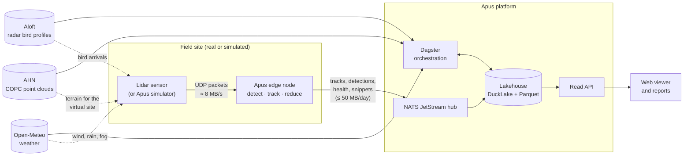
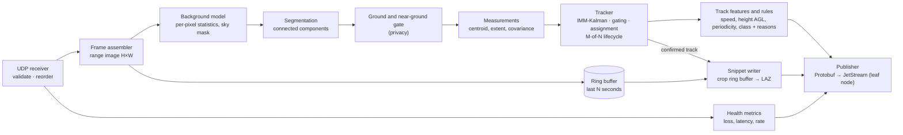
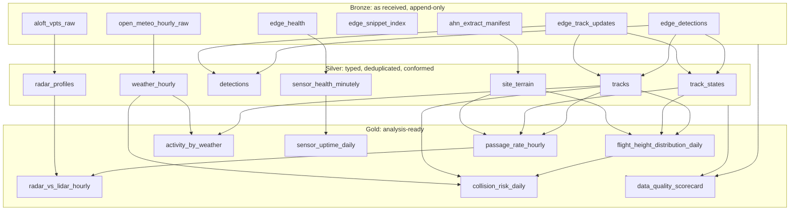

# Architecture

> Target architecture for Apus 1.0. Components are built milestone by milestone as described in
> [ROADMAP.md](https://github.com/soheil-mp/apus/blob/main/ROADMAP.md); decisions are recorded in [docs/adr](adr/README.md).

## 1. System context



Dotted lines exist only in simulation mode: the simulator uses the same public data to build a
realistic virtual site ([ADR-0003](adr/0003-radar-driven-synthetic-lidar.md)).

## 2. Edge node



Design rules:

- **Bounded everything.** Ring buffer, queues and the local JetStream stream have fixed limits;
  overload drops the oldest raw frames first, never tracks.
- **Privacy on the device.** Returns below a height-above-ground threshold are removed before
  measurement and before snippets are cut ([ADR-0004](adr/0004-edge-first-data-reduction.md)).
- **Deterministic.** Same packets and parameters give the same tracks
  ([ADR-0002](adr/0002-deterministic-explainable-perception.md)).

## 3. Data flow and layers



| Layer | Written by | Contract | Retention (local dev) |
| :-- | :-- | :-- | :-- |
| Bronze | Stream landing (micro-batches), Dagster ingestion assets | Schema only; never modified | 30 days |
| Silver | dbt models and Python assets | Full ODCS contract | 180 days |
| Gold | dbt models; Python for Monte Carlo collision risk | Full ODCS contract and freshness SLO | Kept |

Partitioning: bronze and silver by `site_id` and UTC date; gold by `site_id` and month.
Back-fills re-materialise whole partitions, so every write is idempotent.

## 4. Naming and layout

**Message subjects** ([ADR-0005](adr/0005-edge-transport-nats-jetstream.md)):

```text
apus.{site}.{device}.detections.v1
apus.{site}.{device}.tracks.v1
apus.{site}.{device}.health.v1
apus.{site}.{device}.snippets.v1
apus.{site}.{device}.advisories.v1
```

**Object storage:**

```text
s3://apus-lake/                     DuckLake-managed Parquet data
s3://apus-raw/aloft/{radar}/{yyyy}/{radar}_vpts_{yyyymmdd}.csv
s3://apus-raw/open-meteo/{site}/{yyyy}/{mm}/{dd}.json
s3://apus-raw/ahn/{site}/{version}/extract.copc.laz
s3://apus-snippets/{site}/{yyyy}/{mm}/{dd}/{track_id}.laz
```

## 5. Orchestration

| Asset group | Partitions | Trigger |
| :-- | :-- | :-- |
| `external/aloft` | radar × day | Sensor: the daily file appears about three days late; checks every 6 h |
| `external/weather` | site × day | Daily schedule, plus re-fetch when the archive revises recent days |
| `external/terrain` | site | Manual, or when the site configuration changes |
| `lake/compaction` | site × hour | Hourly schedule |
| `dbt/*` | site × day | Declarative automation when upstream partitions update |
| `risk/collision` | site × day | After `flight_height_distribution_daily` |
| `ops/retention` | — | Daily schedule |
| `ops/budgets` | — | Daily schedule; fails when a storage budget is exceeded |

## 6. Quality gates

| Boundary | Gate |
| :-- | :-- |
| Device → hub | Protobuf schema; message IDs for deduplication |
| Hub → bronze | Pandera schema on each micro-batch; rejects go to a quarantine table with reasons |
| Bronze → silver | dbt tests (keys, ranges, accepted values, relationships); physical plausibility (speed, height) |
| Silver → gold | ODCS contract tests; freshness; row-count anomaly bands (median / MAD) |
| Every layer | Storage budget checks; lineage in Dagster |

## 7. Deployment views

| Environment | How it runs | Purpose |
| :-- | :-- | :-- |
| Laptop | `just up`: Docker Compose profiles (`core`, `pipeline`, `obs`, `app`, `sim`) | Development, demos |
| CI | Compose-based end-to-end smoke test on a short seeded scenario | Regression |
| Local Kubernetes | k3d cluster, Helm charts, Argo CD | Production-like rehearsal |
| Edge device | k3s on arm64 with NATS leaf node and the edge workload | Field profile |
| Cloud demo (optional) | OpenTofu-provisioned VM and object storage | Public demo with teardown |
| Static demo | GitHub Pages: web viewer with DuckDB-WASM over a synthetic sample | Always-on showcase |
