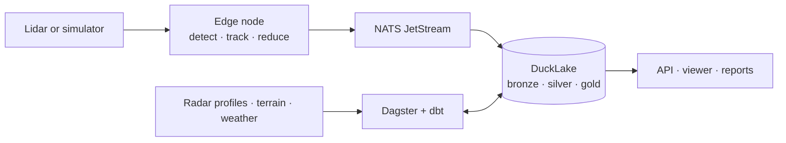

# Apus

**Lidar-based bird-flight monitoring.** Apus turns raw lidar returns into bird tracks with
deterministic, explainable methods, then runs them through a production-grade data platform:
edge streaming, a lakehouse, orchestration, data contracts, quality checks and dashboards.

!!! note "Project status"

    The engineering foundations are in place (workspace, CI, release automation, these docs).
    The product is being built milestone by milestone; see the
    [roadmap](https://github.com/soheil-mp/apus/blob/main/ROADMAP.md) and the
    [open issues](https://github.com/soheil-mp/apus/issues).

## How it fits together

## Where to go next

- **Tutorials**: learn by doing, starting with
  [setting up a development environment](tutorials/development-setup.md).
- **How-to guides**: recipes for specific tasks, such as
  [adding a dependency](how-to/add-a-dependency.md).
- **Reference**: [commands](reference/commands.md) and
  [environment variables](reference/environment.md).
- **Explanation**: the [architecture](architecture.md), the
  [research behind it](research/01-domain.md) and the
  [decision records](adr/README.md).

## Data and attribution

Apus uses only synthetic data and public environmental data, and no personal data. Terrain comes
from AHN (AHN1–4 CC0, AHN5–6 CC BY 4.0), bird-migration profiles from
[Aloft](https://aloftdata.eu/) (CC0; please cite Desmet et al. (2025) and acknowledge OPERA), and
weather from [Open-Meteo](https://open-meteo.com/) (CC BY 4.0).
